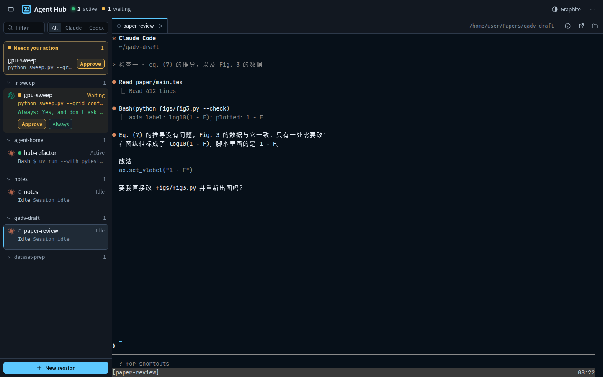
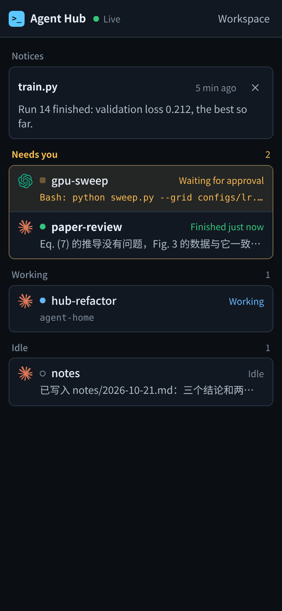
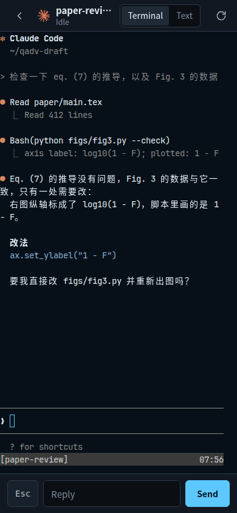

# Agent Hub

[](LICENSE)

Agent Hub 是一个面向 **Claude Code** 与 **Codex CLI** 的会话管理服务，用于集中查看会话状态、事件时间线、审批状态与 tmux 终端入口。

## 界面预览

<p align="center">
  
</p>
<p align="center"><em>桌面端：待处理队列 + 按项目分组的 session 导航 + 工作集标签 + 原生 TUI 主画布</em></p>

<p align="center">
  
  
</p>
<p align="center"><em>移动端：Session 列表与全屏 Terminal 两个模式，保留触控特殊键</em></p>

## 核心能力

- 统一管理 Claude Code 与 Codex CLI 会话
- 记录会话事件并在 Dashboard 中实时展示
- 基于 tmux 进行远程审批与终端接入
- 按项目分组的 session 导航（活跃 / 空闲 / 已结束同组展示）、待处理队列、浏览器工作集标签、session 重命名与详情抽屉
- 单一样式表（无 Tailwind / 无前端构建），5 套暗色 + 5 套亮色主题，并与 Web Terminal 同步
- 手机端独立 Session/Terminal 模式
- 通过 MCP SSE 暴露查询接口
- 支持 Telegram 待审批通知

## 快速开始

```bash
uv sync
./start.sh
# 或
uv run agent-hub serve --hub-id <hub-id>
```

默认情况下：

- Dashboard: `http://localhost:7800`
- API docs: `http://localhost:7800/api/docs`
- MCP SSE: `http://localhost:7800/mcp/sse`

## 远程访问（Tailscale）

Hub 监听 `0.0.0.0`，但无需把端口暴露到公网。推荐用 [Tailscale](https://tailscale.com/) 组建私有网络，在任意设备上通过 Hub 主机的 Tailscale IP 直接访问：

- 手机上打开 `http://<TAILSCALE_IP>:7800` 即可随时查看会话、远程审批
- 嵌入式终端（端口 7700）同样经 Tailscale 访问，可直接在手机上接入 tmux
- 跨机器访问：辅助机设置 `export AGENT_HUB_URL="http://<TAILSCALE_IP>:7800"` 后即可把事件推送到 Hub
- 全程走 Tailscale 加密隧道，不开放任何公网端口，比端口转发更安全

> 如果你有自己的云服务器，也可以用 [Nebula](https://github.com/slackhq/nebula) 自建 lighthouse 作为替代。中转节点掌握在自己手里，延迟更可控、通常更快。Hub 监听 `0.0.0.0`，对 Tailscale / Nebula 等任意私有网段都是开箱即用的。

详细配置见 `SETUP.md`。

## Web Terminal（嵌入式终端）

Dashboard 右侧的嵌入式终端由独立的伴生服务 **[web-terminal](https://github.com/BoZhen/webterminal)** 提供（默认端口 7700），负责把 tmux 会话以持久化终端的形式渲染到浏览器中。Hub 通过 iframe 嵌入它，用于终端预览与远程审批。

现代工作台通过 `embed=1`、`theme=<id>` 与受限的父子页面生命周期消息协调 Web Terminal。主题切换、连接状态与移动端可见性会同步，但终端输入仍只走 Web Terminal 自己的 PTY/WebSocket 通道。

该服务需单独部署，安装方式见其仓库说明与本仓库 `SETUP.md` 的「Web Terminal」一节。

### Claude Code

Claude 通过本地 hooks 将事件推送到 Hub。推荐按 `SETUP.md` 或本文仓库中的配置示例完成接入。

### Codex CLI

支持两种方式：

1. **推荐：Codex 原生 hook 模式**  
   Codex 自带 hook 机制（`~/.codex/config.toml` 的 `[features] hooks = true` + `~/.codex/hooks.json`）。把 `scripts/codex-hub-hook.sh` 注册进去，Codex 事件就会桥接到 Hub，不需要 oh-my-codex 之类的包装层。配置步骤见 `SETUP.md` 2.6。

2. **回退：tmux 扫描模式**  
   未配置 hook 时，Hub 仍可通过 tmux pane 扫描发现 Codex 会话并提供基础管理能力，但会话只有合成 id，没有事件时间线。

注意：Codex 在第一条 prompt 提交时才触发 SessionStart hook。刚启动、还没说话的 Codex 会话在 Hub 里先以扫描得到的合成 id 出现，第一条 prompt 之后自动换成 Codex 自己的会话 id。

## 会话跟踪范围（仅 tmux）

Agent Hub 以 tmux 作为会话持久化、远程审批与终端接入的载体，因此**只跟踪运行在 tmux 中的会话**。

在 tmux 之外启动的 CLI 会话——例如通过 Claude Agent SDK / headless 模式把 `claude` / `codex` 当子进程运行的 GUI 控制台——会被 Hub 主动忽略：它们没有可供 attach / 审批 / 状态探测的 tmux pane，记录下来也只会变成无法被清理的 `idle` 僵尸。这类会话由各自的控制台自行管理，与 Agent Hub 并行共存、互不干扰。

> 即便全局 hooks 会对机器上所有 CLI 会话触发，Hub 也会在事件入口直接丢弃这些没有 tmux 的会话，因此无需为它们单独关闭 hook，也不会把数据库越喂越大。

## 历史会话自动清理

`stopped`（已结束）的会话——其 tmux 已不存在——可以随时从侧栏或抽屉点 Resume 恢复（见下），但留着不管只是历史杂物。Hub 在每次 sweep 时会**自动删除停止时间超过保留期的 stopped 会话及其事件**：

- 由环境变量 `AGENT_HUB_STOPPED_RETENTION_DAYS` 控制，默认 **14** 天；设为 `0` 则永久保留、不自动清理。
- 删除之后 Hub 就不再记得这个 session 的 id 和目录，Resume 按钮也随之消失；需要的话仍可在终端里手动 `claude --resume <id>`。
- 删除的只是 Hub 的记录；Claude / Codex 的 transcript 仍在本地磁盘，日后 `--resume` 不受影响。

> 想立刻整理已堆积的旧记录，也可以在 Dashboard 的 `/stopped` 页一键 Clear。

## 恢复会话（升级 CLI、重启机器之后）

Hub 记着每个 session 的 tmux 名、目录和启动参数（`tool`），恢复就是用这些重建 tmux，并在里面运行 CLI 自己的恢复命令：Claude 是 `claude --resume <id>`，Codex 是 `codex resume <id>`（有真实 UUID 时；只有扫描得到的合成 id 时退回选择器）。审批与沙箱跟随你自己的 Claude / Codex 配置，Hub 不加参数；旧版本启动的行（`claude-yolo` / `codex-yolo` / `omx-yolo`）恢复时仍按当时的参数补上。TUI 由 CLI 自己从 transcript 重画，tmux 的滚屏缓冲不会保留。

- **已结束的 session**：侧栏行 hover 或抽屉里的 **Resume**。升级 claude / codex 后退出重开就走这里。CLI 退出或恢复失败时窗格退回一个交互 shell，tmux 和记录都还在。
- **整机重启**：Hub 启动 2 秒后自动把 tmux 已消失的 active/idle session 逐个恢复（间隔 0.5 s）。`AGENT_HUB_RESTORE_MODE=shell` 可改为只重建 tmux、打印命令、由你手动决定。
- Hub 服务自身重启不影响任何 session（tmux 都还在）。
- 抽屉里的 "Resume with" 一行显示将要运行的命令；`GET /api/sessions/{id}` 的 `resume_command` 字段是同一个值。
- 第二个 Claude 账号：把它的 `CLAUDE_CONFIG_DIR` 目录写在 `AGENT_HUB_CLAUDE2_CONFIG_DIR`（默认 `~/.claude-alt`）。目录存在时 New session 多出 "Claude Code (account 2)"，这类 session 的行带 `account 2` 标记，恢复和 fork 都会带上同一个变量。该目录里的 `settings.json` 也要配好 Hub 的 hook，否则会话不会出现在 Hub 里。

## 常用页面

- `/`：工作台。侧栏按项目分组，每个项目下依次列出等待审批、活跃、空闲、已结束的 session 以及该目录下未被跟踪的 tmux；右侧是工作集标签与嵌入式终端，每个打开的标签各自保持一条终端连接，切换标签不重连；session 详情与重命名在右侧抽屉里
- `/?session={id}`：直接打开某个 session 的终端（手机上进入全屏 Terminal 模式）
- `/sessions/{id}`：单会话完整页（抽屉的降级页，含完整事件列表）
- `/agent`：Monitor 只读助手
- `/idle`、`/stopped`、`/tmux`：保留为跳转，回到工作台

## 常用接口

- `POST /api/events`
- `GET /api/sessions`
- `GET /api/sessions/{id}`
- `POST /api/sessions/{id}/approve`
- `GET /api/stats`
- `WS /ws`
- `GET /mcp/sse`

## 文档导航

- `DESIGN.md`：系统框架、运行拓扑、接口分层与核心设计
- `SETUP.md`：安装、启动与 hook 配置
- `ROADMAP.md`：开发路线记录

## 开发说明

项目主代码位于 `src/agent_hub/`，测试位于 `tests/`。

如需理解系统架构、模块分层、tmux 设计、状态机与接口关系，请直接阅读 `DESIGN.md`。

## License

[MIT](LICENSE)
